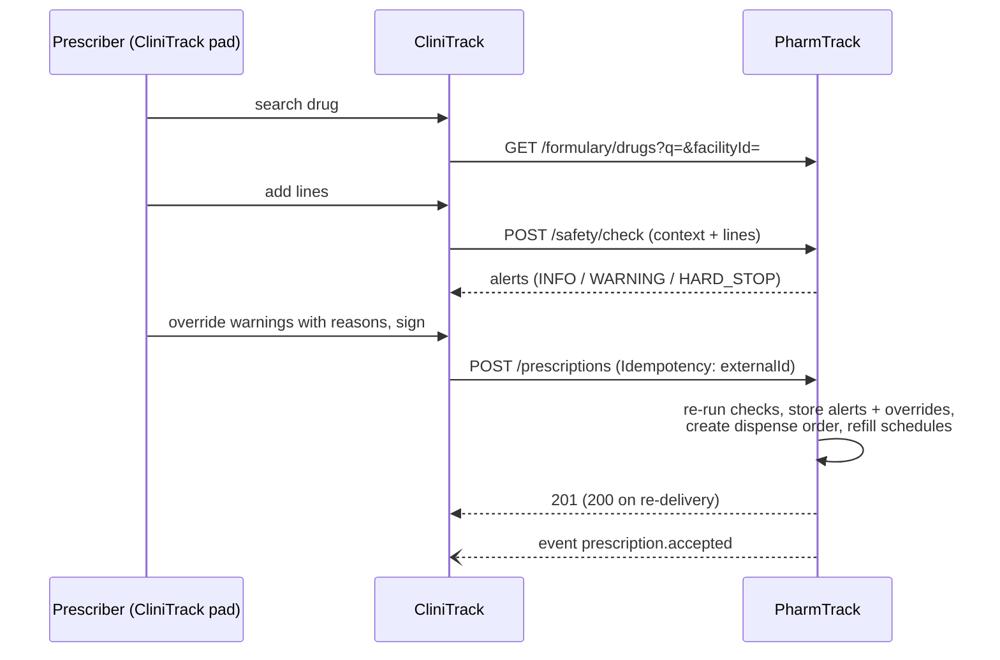
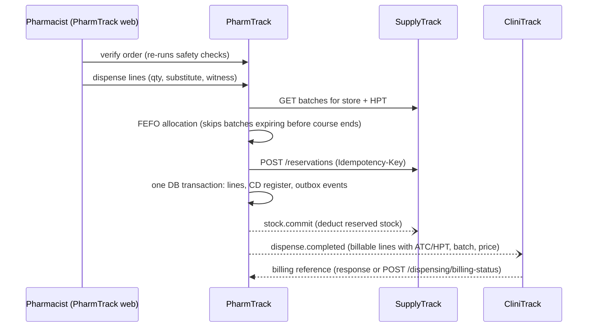

# PharmTrack architecture

PharmTrack is the pharmacy module of the SynergyOne suite. It is the source of
truth for drug data and medication safety, and it runs the dispensing and refill
workflow. The brief is in [PROMPT.md](PROMPT.md).

## Who owns what

| Concern | Owner | PharmTrack keeps |
|---|---|---|
| Drug master, formulary, WHO ATC and PPB HPT codes | **PharmTrack** | Everything |
| Safety rules: allergies, interactions, contraindications, dose limits, pregnancy/lactation | **PharmTrack** | Everything |
| Adverse drug reactions (PPB pharmacovigilance) | **PharmTrack** | Everything |
| Dispensing queue, pharmacist verification, labels, controlled-drug register | **PharmTrack** | Everything |
| Refill schedules and patient SMS reminders | **PharmTrack** | Everything (SMS consent mirrored from CliniTrack) |
| Prescription pad UI | CliniTrack | Signed prescriptions it receives |
| Billing, invoicing, payment, SHA/DHA claims and reports | CliniTrack | Billing reference and status per dispensed line |
| Patients and encounters | CliniTrack | Patient id, encounter id, SMS first name / phone / consent |
| Stock levels, batches, expiry, stores, procurement | SupplyTrack | Batch number, expiry and reservation id per dispensed line |

The **PPB HPT code** is the drug identifier in every message between the three
systems. The **WHO ATC code** travels with it for classification and reporting.

## Stack

- **API**: NestJS 11 (`apps/api`), TypeScript, class-validator DTOs, Swagger at `/docs`.
- **Database**: PostgreSQL via Prisma (`apps/api/prisma/schema.prisma`, migrations in `apps/api/prisma/migrations`).
- **Web**: Next.js 15 (`apps/web`) for pharmacy staff: dispensing (verify, dispense, labels, returns), refills, patient safety records, formulary. CliniTrack renders the prescription pad itself.
- **Jobs**: `@nestjs/schedule` crons for the outbox dispatcher (10 s), SMS sender (1 min) and refill reminders (07:00 Africa/Nairobi).

### Code layout (`apps/api/src`)

| Folder | What it does |
|---|---|
| `domain/` | Pure, framework-free rules: ATC/HPT codes, safety engine, FEFO and dispense states, refill maths, SMS templates. Fully unit tested. |
| `formulary/` | Drug master, versioning, facility formularies, substitution groups, price lists, ATC/HPT bulk import. |
| `safety/` | Loads patient records and rules from the database and runs the safety engine. `POST /safety/check` for the prescription pad. |
| `records/` | Allergies (shared with CliniTrack) and ADRs with PPB export. |
| `prescriptions/` | Receives signed prescriptions from CliniTrack, idempotently. Medication history. |
| `dispensing/` | Queue, verification, FEFO dispensing via SupplyTrack, billing to CliniTrack, returns, controlled-drug register. |
| `refills/` | Refill schedules, refill requests, daily reminders, SMS notifications and consent. |
| `reports/` | Consumption, antimicrobial use, refill status, safety overrides. |
| `integrations/` | SupplyTrack and CliniTrack clients, SMS gateway adapter, transactional outbox. |
| `common/` | Roles guard, audit log, errors. |

## Workflows

### Prescribing (pad in CliniTrack)



### Dispensing and billing



Returns send `stock.return` to SupplyTrack and `dispense.returned` to CliniTrack
so the bill is reversed.

### Refills and SMS

```mermaid
sequenceDiagram
  participant Job as Daily job 07:00 EAT
  participant PT as PharmTrack
  participant SMS as SMS gateway
  participant Pt as Patient
  Note over PT: Initial fill dispensed → nextDueDate = fill date + days of supply
  Job->>PT: refresh statuses (UPCOMING → DUE → OVERDUE)
  Job->>PT: queue reminder (3 days before, due day, overdue)<br/>only if patient opted in
  PT->>SMS: send (retries with backoff)
  SMS->>Pt: "Habari Amina, ..."
  SMS-->>PT: delivery report
  Pt->>PT: comes in → POST /refills/:id/request
  PT->>PT: normal queue; EARLY_REFILL warning if before window
  PT--)CT: dispense.completed with fillType REFILL, fillSequence n
```

Days of supply = quantity ÷ (dose ÷ strength × doses per day) when dose and
strength share a unit, otherwise the prescribed duration.

## Safety policy

| Severity | At prescribing | At verification |
|---|---|---|
| INFO | Shown | Shown |
| WARNING | Needs a prescriber override with a reason (5+ chars) | Needs the pharmacist's own override |
| HARD_STOP | Blocks signing | Blocks dispensing |

Checks: formulary status (facility status overrides suite status, except
DISCONTINUED), allergies by drug or ATC class (confirmed severe → hard stop),
drug-drug interactions by ATC prefix (with current medications from recent
dispenses), drug-disease contraindications by ICD-10/11 prefix, duplicate
therapy (same ATC level 4), dose limits (age, weight, CrCl, hepatic), pregnancy
and lactation, early refill. Every alert and override is stored in `SafetyAlert`.

## Integration patterns

- **Idempotency**: inbound prescriptions are keyed on CliniTrack's `externalId`;
  outbound messages carry an `Idempotency-Key`. Any `POST`/`PUT`/`PATCH` to
  PharmTrack may also send `Idempotency-Key`: a repeat with the same body
  replays the stored response (header `idempotent-replay: true`), a repeat with
  a different body gets `422`, and a repeat while the first is still running
  gets `409`. Failed requests (4xx/5xx) are not stored, so they can be retried
  with the same key. Keys are scoped to the caller.
- **Transactional outbox**: events are written in the same transaction as the
  state change, then delivered with exponential backoff (30 s → 1 h, 10 attempts,
  then `DEAD`). 4xx responses are not retried. The **Integrations** screen
  (`GET /integrations/summary`, `/integrations/outbox`) shows waiting, failed and
  dead messages; an administrator can retry one (`POST /integrations/outbox/:id/retry`),
  which is audited and resets failed billing lines.
- **Event contracts**: every event PharmTrack sends has a JSON Schema in
  [`docs/api/events`](api/events). The e2e suite validates every CliniTrack event
  and SupplyTrack payload it produces against them, so a change to a payload
  fails CI until the schema (and the other team) agrees.
- **Stock**: reserve synchronously (so we know we have it), deduct through the
  outbox. If the local transaction fails the reservation is released; SupplyTrack
  must also expire unconfirmed reservations.
- **SupplyTrack events in**: SupplyTrack posts `batch.recalled`, `stock.low`,
  `stock.out` and `stock.restored` to `POST /integrations/supplytrack/events`
  (role `SYSTEM`). A recalled batch is never allocated again, even if SupplyTrack
  still lists it, and the recall screen lists every patient who received it
  (traced through dispense lines) until a pharmacist marks it handled.
- **Auth**: `RolesGuard` with roles PRESCRIBER, PHARMACIST, PHARMACY_TECHNICIAN,
  STORE_KEEPER, ADMINISTRATOR and SYSTEM (service accounts). With
  `AUTH_MODE=oidc` the API verifies SynergyOne SSO bearer tokens (signature from
  the issuer's JWKS, issuer, audience, expiry). Roles come from the
  `SSO_ROLES_CLAIM` claim (a dotted path such as `realm_access.roles` works),
  optionally renamed with `SSO_ROLE_MAP`; the facility comes from
  `SSO_FACILITY_CLAIM`, or the `x-facility-id` header when the token has none.
  The web app signs in with authorization code + PKCE. Local development can
  still use `AUTH_MODE=dev-headers` (`x-user-id` / `x-user-roles`), which the API
  refuses in production.
- **Audit**: every change writes `AuditLog` (actor, role, before/after).

Contracts: [CliniTrack](api/clinitrack-contract.md), [SupplyTrack](api/supplytrack-contract.md),
full REST surface in [openapi.json](api/openapi.json).

## Assumptions to confirm

1. **PPB HPT code format.** Validation is permissive (`^[A-Z0-9][A-Z0-9.\-/]{2,31}$`)
   until the official format is confirmed; set `HPT_CODE_PATTERN`. The real check
   is that the code exists in the imported HPT list.
2. **PPB ADR export format.** `GET /adrs/:id/ppb-export` maps to the PPB suspected
   ADR form fields; confirm against PPB's current e-reporting schema (or E2B R3).
3. **CliniTrack and SupplyTrack endpoints.** The contracts in `docs/api` are
   PharmTrack's proposal; adjust the clients once those teams confirm.
4. **SMS gateway.** `SMS_PROVIDER=http` posts a neutral payload; a provider-specific
   adapter (e.g. Africa's Talking) is a small change in `sms.provider.ts`.
5. **Hard stops cannot be overridden.** Some facilities allow a consultant override;
   that would be a policy flag.

## Phased plan

| Phase | Scope | Status |
|---|---|---|
| 1. Foundations | Data model, code sets, formulary, safety engine, prescriptions intake, dispensing with SupplyTrack and billing events, refills and SMS, ADRs, outbox, audit, e2e tests | Done |
| 2. Integration hardening | SSO, event schemas with contract tests, idempotent writes, integrations screen with retry, SupplyTrack recalls and stock alerts | Done (contracts still to be confirmed with the CliniTrack and SupplyTrack teams; reservation expiry is on SupplyTrack's side) |
| 3. Pharmacy web app | Verification screen with alerts and overrides, dispense screen with labels, returns, refill queue, patient safety records, formulary admin | Done (label printer formats still to come) |
| 4. Clinical content | Load full WHO ATC and PPB HPT lists, interaction and dose-limit knowledge base, facility formularies | Needs data sources |
| 5. Reporting | SHA/DHA extracts through CliniTrack, stock-out reporting with SupplyTrack, prescriber patterns, PPB ADR submission | Later |
| 6. Standards | FHIR R4 facades (Medication, MedicationRequest, MedicationDispense, AllergyIntolerance, AdverseEvent), Kenya Data Protection Act review (retention, access logs, consent) | Later |
